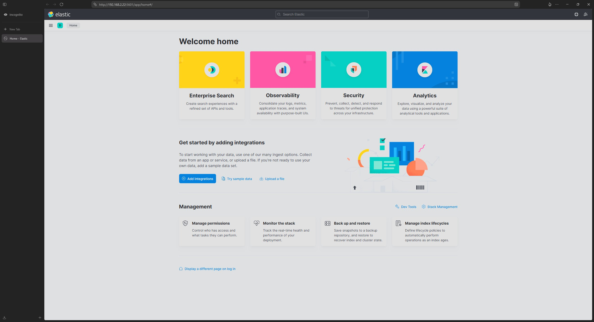
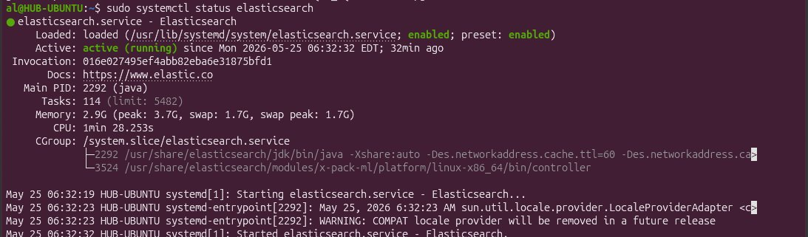
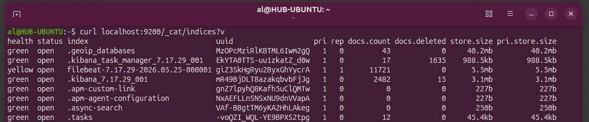
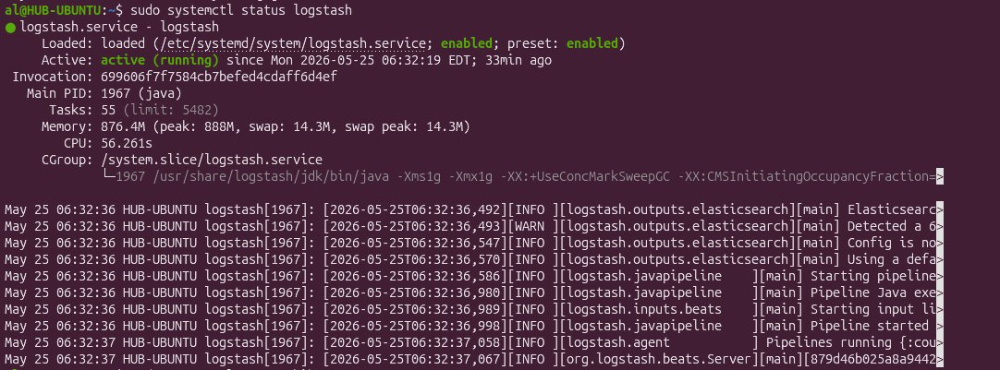
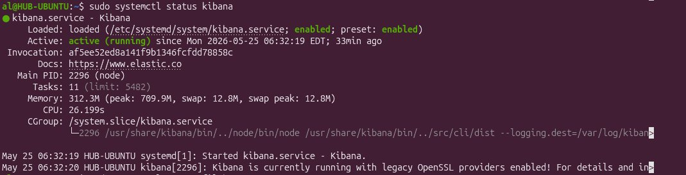
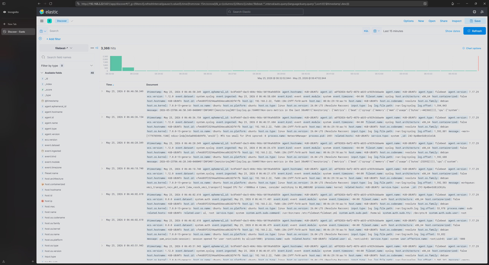
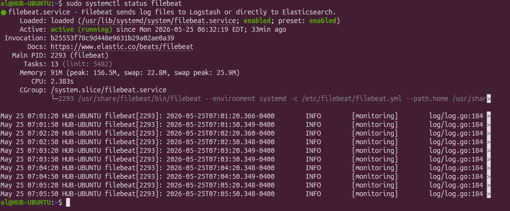
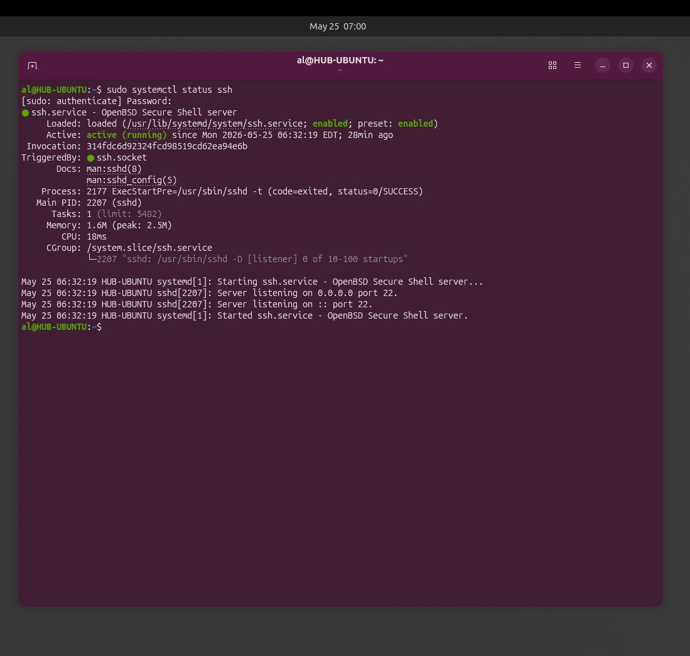

# Screenshots — Elastic SIEM Lab

The ELK stack running and ingesting logs on the Ubuntu VM.

---

## Kibana home page

> Kibana loaded and connected to Elasticsearch on port 5601.

---

## Elasticsearch — running

> `systemctl status elasticsearch` — active (running), enabled on boot, using about 2.9 GB RAM.

---

## Elasticsearch — indices

> `curl localhost:9200/_cat/indices?v` — the `filebeat-7.17.29-*` index holds 11,721 ingested documents, so the pipeline is working end to end.

---

## Logstash — running

> `systemctl status logstash` — active (running); the Beats input listener is up.

---

## Kibana — running

> `systemctl status kibana` — active (running), enabled on boot.

---

## Log events in Discover

> Kibana Discover on the `filebeat-*` index pattern: 3,366 events over 15 minutes, flowing from Filebeat through Logstash into Elasticsearch, with parsed `system.auth` and `system.syslog` fields.

---

## Filebeat — running in the VM

> Filebeat service status confirmed in the Ubuntu VM terminal.

---

## SSH — running

> `systemctl status ssh` — OpenSSH active on port 22 (UFW limits it to the host machine's IP).
